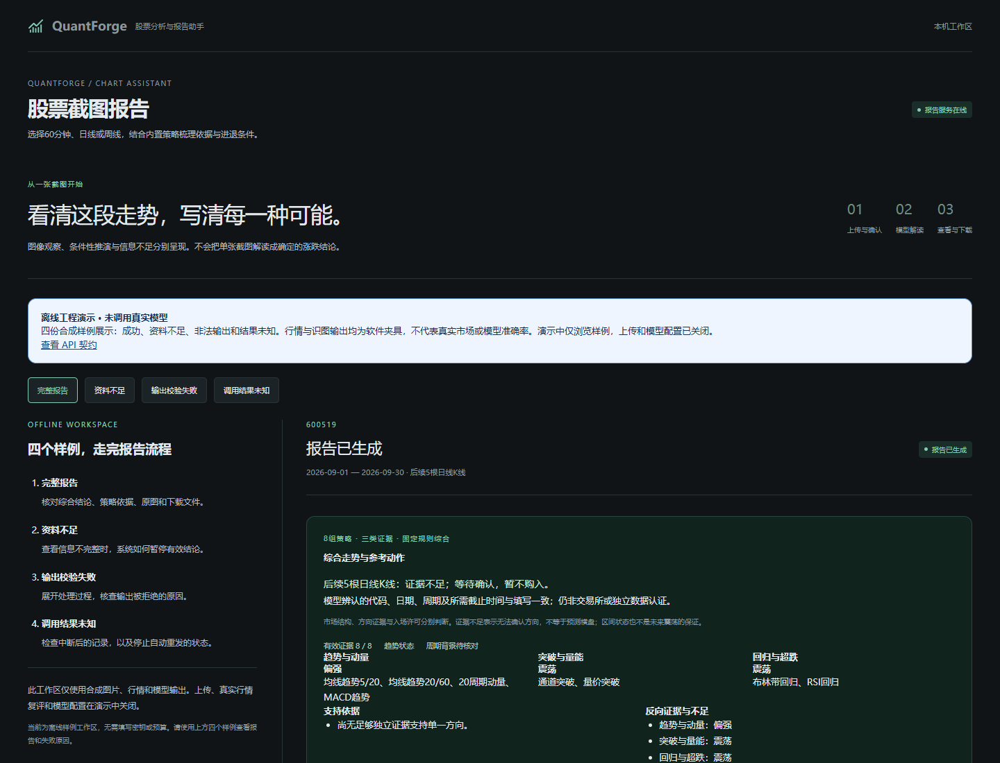
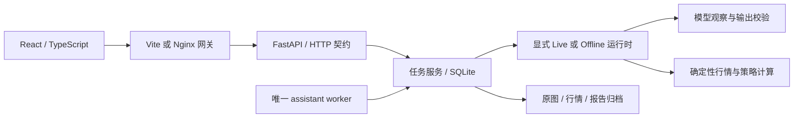

# QuantForge · 多模态截图分析助手

[](https://github.com/Ehahaha1015/quantforge-assistant/actions/workflows/showcase.yml)

上传股票走势图，确认证券、日期和K线周期，由后台任务生成可追溯的结构化报告。
模型图像观察、确定性策略计算和信息不足分别展示，支持 Markdown 下载及浏览器打印。
本仓库包含完整前后端和无需模型密钥的离线演示。



## 快速体验：无需 Docker

安装 **Python ≥3.12、Node.js 24、uv 0.12.9**，在 PowerShell、Linux 或 macOS 终端执行：

```sh
git clone https://github.com/Ehahaha1015/quantforge-assistant.git
cd quantforge-assistant
python governance-tools/local_showcase.py --install
```

打开 [本地演示](http://127.0.0.1:4173/#chart-reports)。以后启动可省略 `--install`。
启动器检查端口、依次启动 API 和前端，并验证 `/gateway/api/health` 后才输出 Ready。
按 **Ctrl+C** 停止两个服务；数据保留，下次启动继续使用同一份演示记录。

演示只使用合成图片、行情和识图输出，不需要 API Key 或 QQ 账号。
页面默认打开完整报告，提供“资料不足”“输出校验失败”“调用结果未知”三个对照入口。
演示模式隐藏上传、密钥配置与真实行情复评；连接模式未确认时暂停上传和配置，支持重连。

本地启动器绑定 `127.0.0.1:4173` 和 `127.0.0.1:4188`，若端口被占用会退出，不会停止已有服务。
数据存放在 `local-smoke/local-showcase-data/`，日志在 `local-smoke/local-showcase/`。
本地模式使用显式离线运行时；需要容器网络隔离时使用下面的 Docker 入口。

## Docker 演示

先启动 Docker Desktop / Docker Engine，确保 Compose 可用。Windows：

```powershell
./run_showcase.ps1 -Build
```

Linux / macOS：

```sh
sh ./run_showcase.sh
```

打开 [容器演示](http://127.0.0.1:4182/#chart-reports)。首次构建需下载依赖。
`localhost:4182` 会转到保留相同端口的 `127.0.0.1:4182`。

使用独立的 `quantforge-showcase` Compose 项目和 `showcase-data` 卷。
API 位于内部网络、无外部模型或行情网络路由；前端通过 Nginx 同源网关访问 API。
不挂载生产数据或账号目录，也不启动个人问答、QQ 或真实前向取数。

```sh
docker compose -f compose.showcase.yaml ps
docker compose -f compose.showcase.yaml logs --tail 80
docker compose -f compose.showcase.yaml stop
```

停止不会删除演示记录。演示目录必须为空或包含正确的 Demo 标记，已有普通数据目录会被拒绝。

## 五分钟验收

| 操作 | 应看到的行为 |
| --- | --- |
| 打开页面 | 明确的“离线工程演示”提示，自动选择完整报告，无密钥输入框 |
| 完整报告 | 综合策略结论、条件性进退参考、策略证据及原图来源 |
| 下载报告 | 下载对应任务的 Markdown；打印入口可保存 PDF |
| 资料不足 | 说明截图无法核对，暂停有效结论和精确价位参考 |
| 输出校验失败 | 显示处理未完成，不自动重试；可展开处理过程 |
| 调用结果未知 | 明确停止自动重发，保留调用预留与状态事件 |
| 处理过程 | 按需加载脱敏事件；失败后可重读，也可刷新后续状态 |
| API 契约 | 从页面链接打开本机说明，再查看 OpenAPI JSON |
| 重启演示 | 保留相同任务和记录，不重新生成四份样例 |

“报告已生成”只代表软件链路完成。资料不足样例也可能生成一份明确拒绝有效结论的报告。
合成样例不代表真实模型识图成功，更不代表股票预测成功。

## 架构与代码



| 目录 | 职责 |
| --- | --- |
| `quantforge-ui/` | React 页面、来源校验、上传与报告、组件测试 |
| `qf-platform/` | FastAPI、任务与预算编排、存储、worker、离线演示 |
| `quantforge/` | 数据契约、策略、风险与回放等确定性核心 |
| `qf-lab/` | 研究协议和工具组件，由平台依赖 |
| `governance-tools/` | 本地启动、验证与白名单源码导出 |
| `deploy/docker/` | 容器构建与同源网关配置 |

同幂等键、同内容返回原任务；同键不同内容拒绝。外部调用前先持久化预算预留。
运行中的请求若在崩溃后无法确认结果，登记为 UNKNOWN，不自动重发。
SQLite 与图像文件不是同一事务，外部请求也不承诺端到端 exactly-once。

更多设计细节见 [架构、状态与事务取舍](docs/INTERNSHIP-ARCHITECTURE.md) 和
[代码阅读、动手任务与面试讲解](docs/INTERNSHIP-INTERVIEW.md)。

产品现状评估、优先级与建议验收标准见
[分析助手后续改进原规划（2026-11-23）](docs/ANALYSIS-ASSISTANT-IMPROVEMENT-PLAN-20261123.md)。
已交付的证据摘要、只读追问、报告对比与验收步骤见
[报告证据助手成品说明](docs/ASSISTANT-ACCEPTANCE-20261123.md)。

## 开发与验证

安装并运行完整的离线检查：

```sh
python governance-tools/ci_showcase.py --install
```

已安装依赖时省略 `--install`。每次生成独立的 `local-smoke/ci-<时间>-<随机标识>/`，
可以在同一个克隆目录重复运行，不覆盖旧证据。
目录内包含覆盖范围、逐项命令/退出码/耗时汇总、25 条契约评测和进程中断/HTTP 幂等检查结果。
指定 `--output-dir <新目录>` 可以选择存放位置，已存在目录会被拒绝。

CI 在 Windows 执行完整 Platform 测试（包括 DPAPI）；Linux 执行截图、个人助手、QQ、worker
及交付工具测试。两边均检查 Ruff、mypy、UI 类型/测试/生产构建、25 条合成输出契约、
7 个真实进程中断点，以及 100 次同幂等键 HTTP 提交。

单独检查前端：

```sh
npm --prefix quantforge-ui run typecheck
npm --prefix quantforge-ui test
npm --prefix quantforge-ui run build
```

开发 API 的启动参数与前端网关说明见 [前端 README](quantforge-ui/README.md)。
离线评测需要 Git 源码上下文。源码 ZIP 解压后应先初始化仓库并提交源码，再运行评测。

## 常见问题

| 现象 | 处理方式 |
| --- | --- |
| Docker daemon 连接失败 | 启动 Docker Desktop，或使用 `local_showcase.py --install` |
| 4173 / 4188 已占用 | 停止对应的旧开发服务后重启；容器演示使用不同的前端端口 4182 |
| 工作区模式无法确认 | 检查启动终端和日志，服务恢复后点击“重新连接工作区” |
| npm / uv 下载中断 | 网络恢复后重试安装命令；保留锁文件，无需重置演示数据 |
| 演示目录被拒绝 | 不要指定普通数据目录；本地启动器使用独立的 `local-smoke/local-showcase-data` |
| UNKNOWN 任务 | 查看事件和调用记录；真实模式还需核查供应商请求及账单，不自动重发 |

## 分享源码

本仓库是可直接克隆的完整单仓库。导出工具也兼容早期组件分别管理的工作区：

```sh
python governance-tools/export_showcase.py --output local-smoke/showcase-source.zip
```

ZIP 按显式白名单收集源码，附逐文件 SHA256，包含当前 README、本地启动器和工作流规范。
不包含依赖环境、生产图片、数据库、预算日志或账号配置。相同输出文件不会被覆盖。

## 能力边界

本项目为 AI 辅助实现的本地单 worker / SQLite 应用，不宣称分布式执行。
合成契约样本验证接受、拒绝与恢复行为，不衡量真实模型准确率。
同幂等键测试不等于不同图片吞吐，离线耗时不包含真实模型延迟。
截图识别与策略结果未经独立预测优势验证，报告不提供实盘交易权限。
真实模型服务的配置及新调用仍受原有授权与累计预算约束；演示无需这些配置。
