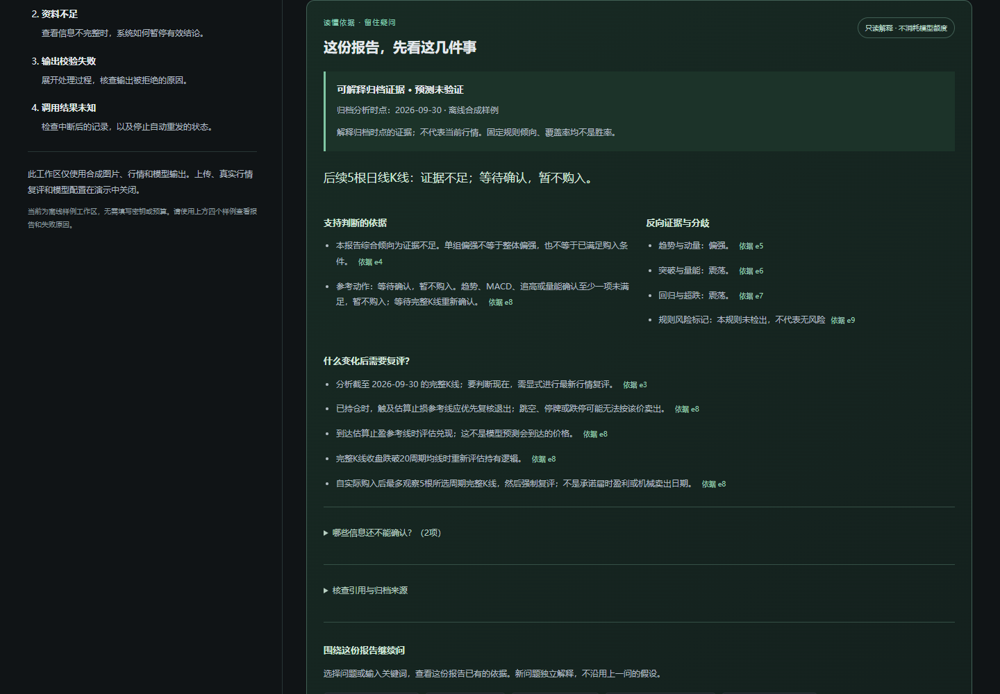

# 报告证据助手：成品验收说明

日期：2026-11-23。对应本次自主实现的报告证据与跟进版本。

## 打开成品

在仓库根目录运行：

```powershell
python governance-tools/local_showcase.py
```

打开 <http://127.0.0.1:4173/#chart-reports>。首次安装依赖时加 `--install`。
这是独立合成演示，不需要模型密钥，也不会启动真实行情取数或私人聊天。

真实工作区沿用原启动方式、原任务服务和原预算；本次没有迁移或修改已有运行数据。



## 六步验收

| 操作 | 应看到的结果 |
| --- | --- |
| 打开“完整报告” | “报告已生成”和“可解释归档证据 · 预测未验证”分别显示；列出归档时点、支持证据、反向分歧、复评条件及缺失信息 |
| 点击“依据 e…” | 自动展开对应引用并跳转；默认显示中文字段与归档数值，原始 JSON 在技术详情中 |
| 点击“为什么偏强却要等待？” | 引用固定规则的入场过滤原因及各组方向；不会把偏强等同于允许购入；不会重新调用模型 |
| 输入“今天能涨多少，胜率是多少？” | 明确超出归档证据范围；没有实时取数、未来价位或虚构概率 |
| 切换“资料不足”并追问 | 提示先核对截图，暂停有效综合结论和精确参考；换报告时不会串入上一份追问结果 |
| 选择另一份同口径报告，或筛选分析记录 | 展示两份报告身份、时点、元数据/版本差异；不同证券、周期、复权或期限在 API 层拒绝比较；历史可按代码/日期和状态筛选 |

补充验收：下载 Markdown，能看到分析可用性、引用路径、快照摘要及合成演示标签；打印保留报告解释与演示身份。手机宽度可直接阅读，引用仍可展开。UNKNOWN 样例保留停止重发的原行为。

报告内输入的“重点问题”可以直接点击回答。当前解释支持依据、反向风险、量能与突破、退出/复评、资料核对及概览；新问题独立解释，不使用上一问未确认的假设。最近六条回答只在当前页面暂存，刷新不会写成永久会话。

## 本次已实现的范围

- 新增只读证据摘要、关键结论引用、中文证据详情、受限问题回答及同口径报告对比。
- 证据绑定原报告 SHA256；浏览器核查回答和比较是否对应当前报告版本；快速切换时忽略旧请求结果。
- 对缺交易日、零量、价格跳变、历史不足、未核验日历等标记统一暂停有效结论与精确计划展示，包含旧报告的展示和 Markdown，不改写原始快照及原观察目标。
- 提供日历维护状态与累计调用/任务容量提示。当前核验日历到 2026 年，2027 年继续返回未知；没有填入未经来源核验的未来日历。
- 修正工作区容量耗尽提示，避免引导用户删除数据、重置累计预算。
- 新增真实图片标注包离线评分工具，严格区分合成夹具和人工标注声明，验证图片/输出摘要与图像绑定，拒绝跨开发/封存边界的同组或同图数据。

问题接口没有外部工具、模型调用、行情请求或持久化写入。所有追问内容均以文本处理，不执行图片、问题或回答中的指令。取最新行情仍使用原显式复评入口，离线演示继续禁止外部取数。

## API 契约

| 路径 | 作用与约束 |
| --- | --- |
| GET `/api/chart-analyses/{id}/assistant` | 类型化报告摘要、结论引用及原字段，附快照身份 |
| POST `/api/chart-analyses/{id}/question` | `{"question":"为什么等待？"}`；最多 600 字，必须使用原本机 `RESEARCH` 模式；只读计算，不增加模型调用 |
| GET `/api/chart-analyses/{id}/comparison?previous_id=...` | 验证两份报告身份与口径后比较，只读 |
| GET `/api/chart-analyses/{id}` | 保留原快照，附当前只读 `analysis_guard`，防止旧 READY 快照绕过现在的展示核对 |
| GET `/api/chart-settings` | 原配置脱敏状态，附容量与日历维护信息；不返回密钥 |

新接口沿用现有 Host/Origin、请求大小、读取期限与错误处理边界。OpenAPI 自动包含新响应模型。上述只读追问 POST 在演示中可用，不允许据此修改配置、触发复评或启动真实请求。

## 真实图片评分工具

```powershell
.\qf-platform\.venv\Scripts\python.exe -m qf_platform.chart_image_evaluation --manifest <已获准标注包目录>\manifest.json --output <新的评分文件>.json
```

输入文件只从标注包目录读取，不能使用绝对路径、上级路径或符号链接跳出目录。图片与归档分析文件分别验证 SHA256，分析文件的 `image.sha256` 必须匹配图片。输出使用排他创建，不能覆盖旧评测。

标注包是独立的私人评测资料，不放入公开 Git。先把经过授权、脱敏的图像和对应归档 JSON 放入包目录。不要拷贝配置、预算数据库、密钥或整个私人工作区。

清单格式示例（摘要与人工标签需要填写真实值）：

```json
{
  "schema_version": "chart-image-labelled-bundle-v1",
  "provenance": "DECLARED_INDEPENDENT_HUMAN_LABELS",
  "protocol_id": "预先冻结的协议身份",
  "cases": [
    {
      "id": "case-001",
      "group_id": "同一证券日期与近重复图片组",
      "split": "SEALED",
      "category": "完整可读日线",
      "image_path": "images/case-001.png",
      "image_sha256": "替换为64位十六进制摘要",
      "analysis_path": "outputs/case-001.json",
      "analysis_sha256": "替换为64位十六进制摘要",
      "expected": {
        "recognized_symbol": "人工从图片标注的代码",
        "recognized_period": "人工标注的可辨认日期原文",
        "recognized_timeframe": "1d",
        "recognized_adjustment": "RAW",
        "image_quality": "READABLE"
      },
      "expected_alignment": "CONSISTENT",
      "annotators": ["标注者A", "标注者B"],
      "adjudication": "分歧处理过程或双方一致的记录"
    }
  ]
}
```

`expected` 必须含全部五个字段，不能辨认时显式填 `null`；日期和代码使用严格字符串匹配，因此标注协议需预先统一表达。`expected_alignment` 为 CONSISTENT/MISMATCH/UNCONFIRMED，分别表示可核对、明确冲突、资料缺失。失败或缺报告输出计为字段错误和相应拒答，不能从分母剔除。

工具输出总体、开发/封存分组及输入类别的字段匹配率、格式通过率、错误放行、不必要拒答和 Wilson 区间，并保留逐样本结果及清单身份。合成包的 `provenance` 必须为 `SYNTHETIC_FIXTURE`；带离线来源的输出不能冒充真实标注包。

人工身份与独立标注是操作方声明，工具不证明标注者身份或数据授权。相关图片不是独立样本，Wilson 区间不能替代日期/证券分组的研究推断。工具只衡量字段识别与准入判断，不能计算自然语言事实性或未来预测准确率。

## 尚待外部证据的验收

本次软件成品不代表原计划全部研究和用户验证已经完成。以下项目保持“未验证”：

- 尚无独立真实图片标注包及对应实际识图评分；本次仅用合成数据验证评分工具与产品行为。
- 没有新增真实模型调用，也未证明提示词或模型识图准确率提高。
- 2027 年官方交易日历、个股停牌、公司行动与量额单位还需要获准的外部数据核验。
- 预测优势、可交易收益、长期前向效果及真实用户任务试用仍需要各自的独立证据。
- 本轮没有增加持久化自由对话、自动纠错重发、消息提醒、券商权限或多 worker。

后续继续遵循[原改进计划](ANALYSIS-ASSISTANT-IMPROVEMENT-PLAN-20261123.md)。其中的真实标注、数据权限和前向观察不能用更多软件夹具替代。

## 验证方式

规范检查入口仍为 `python governance-tools/ci_showcase.py`。Windows 运行完整 Platform 套件（含 DPAPI），Linux 运行活跃截图、个人助手、QQ 和 worker 路径。新增测试文件遵循已有 `test_chart*.py` 选择范围；原断言与覆盖范围保留。

新增验证覆盖：逐条引用精确回到归档字段、问题/比较不改写预算与历史、元数据与期限不匹配拒绝、越界问题和跨证券问题拒答、坏数据抑制旧精确计划、日历到期、旧版 Markdown 兼容、异步切换隔离、悬空引用与伪造能力声明拒绝，以及标注包完整性与样本污染检查。

2026-11-23 本机验收：规范检查完整通过，434 项 Platform 测试（含 Windows DPAPI）、51 项前端测试、Ruff、mypy、前端类型检查与生产构建均通过；25 条合成契约、7 个进程中断点及 100 次同幂等键 HTTP 提交验证通过。Playwright 实测桌面和 390 像素窄屏、证据展开、只读追问与报告比较；两种宽度均未出现横向溢出。另对最终引用展示和旧版兼容补充回归检查。以上为软件行为验收，不是模型或预测效果验收。
