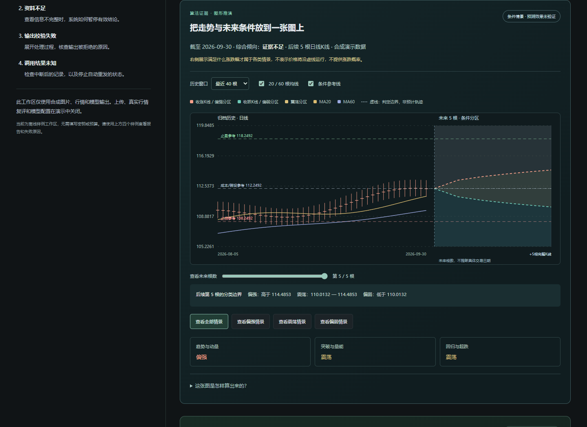

# 走势与条件情景可视化

2026-11-23。基于现有算法与已归档行情的只读图形展示。

后续交互更新：页面已默认采用[上传即分析与分层展示](IMAGE-FIRST-UPLOAD-20261123.md)。元数据或复权未完全对齐时可先显示独立行情背景或图像情景；本文原有完整图表口径继续适用于核对通过的报告。



## 网页使用

刷新股票截图报告页面，选择一份已生成且完成核对的报告。报告上方新增“把走势与未来条件放到一张图上”。原上传入口仍在 <http://127.0.0.1:4173/#chart-reports>。

- 左侧为已归档历史 K 线，可切换最近 20、40、80 或 120 根，显示 20/60 根收盘均线。
- 悬停、点击或键盘聚焦历史 K 线，可查开高低收及均线数值。
- 右侧为未来条件分区，范围使用该报告原有观察期限；滑动“查看未来根数”或点选未来分区，读取对应分类边界。
- 切换偏强、震荡、偏弱情景，高亮对应区域并展示报告原有触发、推演、失效条件。
- 原有成本/假设参考、止损参考和止盈参考可以开关；填写成本可能与归档收盘不同，不能混同。
- 手机端图表局部横向滚动；打印保留图表、时点和边界说明。

已有报告也可使用，不需要重新生成或重新识图。截图身份、复权、行情质量未通过核对，或缺少可验证归档时，展示阻断原因，不绘制价格情景。

独立合成演示仍可通过 `python governance-tools/local_showcase.py` 启动。若该端口正在运行真实上传工作区，应先停止对应服务，不能用演示目录替换真实目录。合成图只验证软件展示，不代表真实识图成功或预测有效。

## 算法口径

未来边界直接复用 Core 现有 `chart_evaluation.label_threshold`：

```text
方向评测阈值 = 0.5 × √后续根数 × ATR14 / 归档收盘参考
上边界 = 归档收盘参考 + 0.5 × ATR14 × √后续根数
下边界 = 归档收盘参考 - 0.5 × ATR14 × √后续根数
```

在原报告期限处，区间收盘变化高于上界判为偏强，低于下界判为偏弱，含上下界的中间区域判为震荡。这是已有方向评测的分类规则，**不是预计价格路径、置信区间、目标价格或概率分布**。中间根数仅展示同一公式如何变化，不表示原算法生成了逐根预测。

ATR14 和收盘参考取自该报告的综合指标；均线使用完整归档数据逐根计算，始终只使用当根及此前收盘价，再截取展示窗口，避免截取窗口后丢失预热历史。未来横轴用完整 K 线根数，不推断未经核验的具体交易日期。支持原有 60 分钟、日线及周线期限。

综合倾向、证据组与条件性计划沿用报告结果；不因选择某个情景而修改后端方向或入场许可。综合方向为 UNCLEAR 时仍可查看各条件边界，同时明确显示“证据不足”。

## 来源和授权边界

GET `/api/chart-analyses/{id}/visualization` 返回类型化的 `chart-visualization-v1`，包含报告快照、原始行情与标准行情 SHA256、历史 OHLC/均线、边界、已有计划参考线，以及 `model_calls=0`、`market_fetches=0`、`forecast_validated=false`。

服务仅读取归档：验证原响应摘要，使用既有行情解析器重建数据并核对标准行情摘要，再检查末根收盘与报告指标相同。离线数据使用明确标记的合成归档解析。任何摘要冲突、缺少预热数据、无有效 ATR 或价格超出正值范围都会停止绘图。

前端进一步校验 K 线顺序与 OHLC 关系、期限、末值、报告/数据版本、每个未来边界与公式的一致性。请求中止或快速切换报告时不会展示上一份请求结果。

没有新增付费模型调用、外部行情请求、后台 worker、调度任务、预算域或交易权限。原图不会被上传给新的服务。旧报告、观察目标和累计用量不被改写。

## 验证

本机完整检查通过：440 项 Platform（含 Windows DPAPI）、55 项前端测试，Ruff、mypy、前端类型检查和生产构建；25 条合成契约、7 个真实进程中断点与 100 次同幂等键 HTTP 提交也通过。

新增用例核对：归档 OHLC 与预热均线、现有 ATR 公式、三种周期、坏图/坏数据阻断、摘要篡改、异常数值、跨报告版本拒绝、交互窗口/情景及只读调用边界。浏览器检查覆盖桌面、390 像素窄屏、未来根数选择与资料不足时清空图表。以上只证明软件行为，不证明预测效果。
