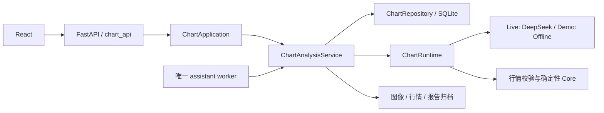
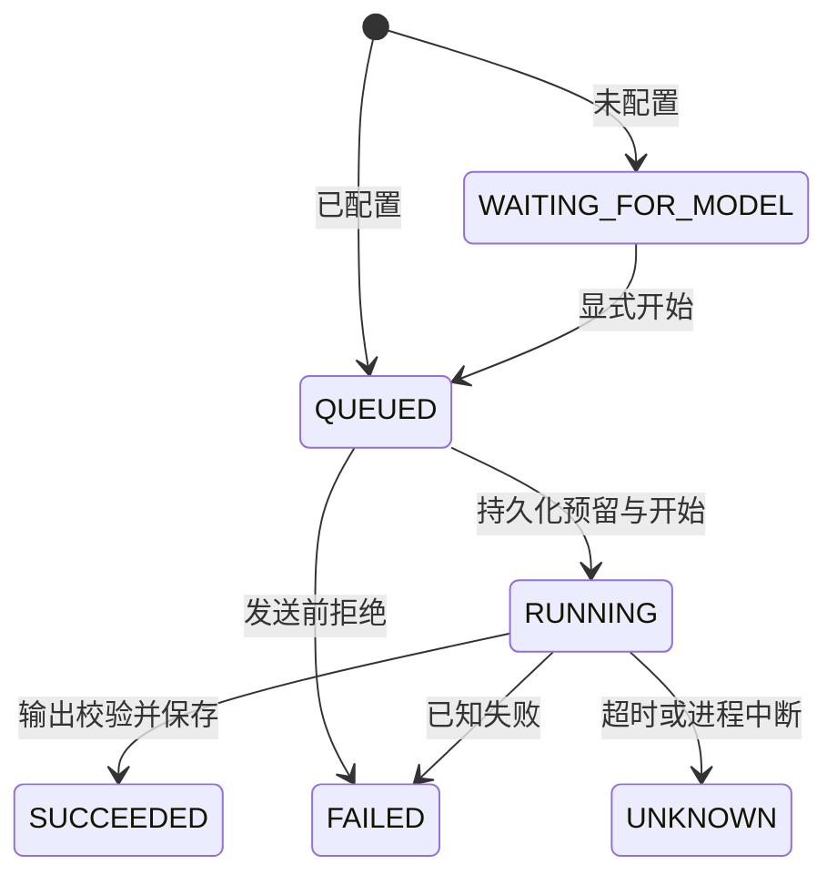

# 架构与三个关键设计取舍

## 请求到报告

`chart_api.py`负责HTTP契约与错误映射；`chart_http.py`先检查Host/Origin、模式、
重复控制头、请求长度及读取期限。同步用例由FastAPI在线程池中运行，模型调用不在HTTP请求内。
POST返回任务，worker稍后处理。没有把HTTP异步框架等同于模型并行执行。

`chart_application.py`负责网页提交来源及脱敏事件查询；`chart_analysis.py`仍拥有任务状态、
预算规则和报告编排；`chart_repository.py`集中SQLite连接及append-only事件。
`chart_runtime.py`把行情和模型外部效果显式注入，生产默认Live，Demo显式使用Offline。
既有兼容服务器`make_server`保留供旧后端调用；`server --chart-only`的生产入口已用FastAPI。
OpenAPI对上传/配置/命令及主要报告响应建模；复杂算法扩展字段保留版本兼容，并非所有内部事实
均已变成独立的OpenAPI类型。

## 一：幂等和事务

每次提交携带幂等键；存储键唯一，同时保存规范化元数据、图像及策略版本的签名。
同键同内容返回原任务，同键异内容拒绝。SQLite `BEGIN IMMEDIATE`使查重和插入有统一写入边界。
图像以摘要寻址，写入前核对原字节。文件系统与SQLite不是同一事务：极端崩溃可能留下无任务引用
的图像文件，不能因此声称分布式原子性或自动删除全部孤儿原图。

使用SQLite的理由是本地单worker、有限任务量、易复现。WAL及FULL同步保留；连接首次语句有锁，
处理项目真实发现过的WAL辅助文件创建竞争。需要多节点写入时必须重新设计，不将当前测试外推。

## 二：调用预留与未知结果

步骤为持久化调用预留/任务RUNNING，提交事务，再执行外部请求，最后保存结果。
公开行情读取在调用预留之前，避免持数据库写事务等待网络。
OS级文件锁跨越调用，恢复者能区分当前仍在执行的进程和已经退出的旧进程。

恢复看到旧RUNNING时登记UNKNOWN，保留预留，不自动请求。预留完成但尚未真正发送时崩溃也可能
保守判UNKNOWN；这是为了避免重复收费而牺牲部分自动恢复能力。
外部供应商不提供可核验的幂等/查询能力时，本系统不能保证端到端exactly-once。
目前承诺的是本地幂等和未知请求不自动重放，不是确定外部请求绝未重复执行。

金额使用Decimal；保守预留不是供应商账单，不自动退回失败/未知调用预留。
事件触发器禁止普通UPDATE/DELETE，摘要链能发现不一致；拥有完整写权限的人仍可能重建摘要链，
不能称其为抵抗管理员篡改的密码学证明。

## 三：识图输出与有效结论

模型输出先经过大小/JSON/finish_reason/schema校验，再比较证券、日期、周期和复权口径。
模型观察、公开行情和确定性规则结论分别留存；资料不足不能伪装成横盘预测。
Demo图像和行情均合成，来源标为OFFLINE_SYNTHETIC，前端只额外接受精确的Demo来源组合。
它们不会伪装为腾讯HTTPS来源。

25条离线契约样本是手工声明的输入输出预期，可定位拒绝回归，不能衡量自然语言幻觉或识图质量。
已有真实报告的结构/元数据审计也不是人工图像真值。真正模型效果比较需要独立标注、固定数据集、
版本化提示词、受预算约束的新调用，以及与软件夹具分开的统计。

## 可观察性与演示隔离

每个HTTP响应生成服务端request id；进程内仅保留最近1024条方法、状态和耗时，不保留请求体、
密钥或个人对话。任务事件接口按job过滤，只返回序号、时间、事件、状态和错误码。
HTTP trace与任务事件目前是两个维度，不冒充跨服务分布式追踪。

Demo使用独立Compose项目、卷及显式标记；配置接口锁定、复评和观察的外部取数被拒绝。
Demo worker只执行截图任务，不启动QQ、个人问答或前向取数。API网络为internal，无互联网路由。
生产继续用原唯一assistant worker和原授权/预算，不新增模型worker。

## 后续扩展触发条件

只有真实出现多节点写入、任务量或外部查询需求时，才评估数据库/队列替换。
当前没有向量检索需求，不因简历关键词加入RAG。后续优化先保留基线，明确测量对象，再对比结果。
